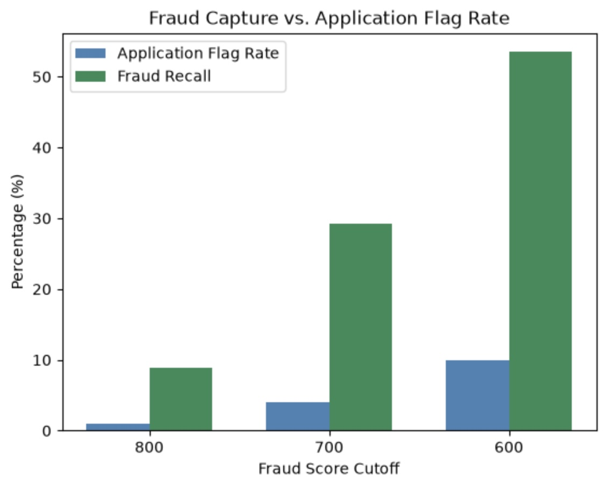

# Fraud Capture Opportunity Analysis

## Project Overview

This project evaluates how adjusting fraud score thresholds affects fraud identification, manual review volume, and operational efficiency.

Using Python and Pandas, I analyzed **10,000 applications from January through June 2025** to compare three fraud score cutoffs: 800, 700, and 600.

The objective was to identify a review strategy that balances increased fraud detection with the operational costs of reviewing legitimate applications.

**Tools:** Python, Pandas, NumPy, Matplotlib, Jupyter Notebook

## Key Findings

The dataset contained **202 labeled fraudulent applications**, representing a baseline fraud rate of **2.02%**.

| Fraud Score Cutoff | Applications Flagged | Flag Rate | Fraud Flagged | Precision | Fraud Recall | False Positive Rate |
|---|---:|---:|---:|---:|---:|---:|
| 800 | 93 | 0.93% | 18 | 19.35% | 8.91% | 0.77% |
| 700 | 395 | 3.95% | 59 | 14.94% | 29.21% | 3.43% |
| 600 | 997 | 9.97% | 108 | 10.83% | 53.47% | 9.07% |

*All application counts represent the full six-month analysis period.*

### Fraud Threshold Comparison



The analysis highlights several important trade-offs:

- **Higher thresholds improve precision:** A cutoff of 800 achieves the highest precision (19.35%) but identifies only 8.91% of labeled fraud.
- **Lower thresholds increase fraud recall:** Reducing the cutoff to 600 identifies 53.47% of labeled fraud while flagging approximately 10% of all applications.
- **Increased fraud identification comes with additional reviews:** Moving from 700 to 600 adds 602 reviews, including 49 additional labeled fraudulent applications.
- **Targeted reviews outperform random selection:** At a cutoff of 700, precision reaches 14.94%, approximately 7.4 times the baseline fraud rate of 2.02%.

## Business Recommendation

**A fraud score cutoff of 600 warrants further evaluation as a potential manual review strategy.**

This threshold identifies 108 of the 202 labeled fraudulent applications while flagging 997 applications across the six-month period.

Compared with a cutoff of 700, it offers substantially greater fraud recall but also increases the number of legitimate applications requiring review.

Assuming a monthly manual review capacity of 500 applications, the 997 flagged applications average approximately 166 reviews per month. However, actual monthly volumes must be evaluated to confirm that capacity would not be exceeded during peak periods.

Before implementing a new cutoff, I would recommend:

1. Validating monthly review volumes against operational capacity.
2. Evaluating manual review costs and customer friction from false positives.
3. Estimating the financial value of additional fraud identification.
4. Comparing additional score thresholds to identify the most effective operational strategy.

**The objective is not simply to maximize fraud recall, but to identify the threshold that delivers the greatest business value within operational constraints.**

## Analysis Methodology

The analysis followed five primary steps:

1. **Data validation:** Inspected missing values, duplicate records, data types, fraud labels, and score distributions.
2. **Data preparation:** Converted application dates to datetime values and created a Boolean fraud indicator.
3. **Exploratory analysis:** Evaluated application volume, baseline fraud rates, and fraud distribution across score ranges.
4. **Threshold analysis:** Grouped scores into 50-point intervals and calculated cumulative review volume, precision, recall, and false positive rates.
5. **Strategy comparison:** Compared three potential manual review thresholds and visualized their operational trade-offs.

## Project Structure

```text
fraud_capture_20261029/
├── data/
│   └── fraud_capture_mini_project.csv
├── images/
│   └── bar_graph_image.jpg
├── notebooks/
│   └── fraud_capture_analysis.ipynb
├── pyproject.toml
├── uv.lock
└── README.md
```

## Running the Analysis

Clone the repository:

```bash
git clone https://github.com/spencerwillard/fraud_capture_analysis_20261104.git
cd fraud_capture_analysis_20261104
```

Install the project dependencies using [uv](https://docs.astral.sh/uv/):

```bash
uv sync
```

Open `notebooks/fraud_capture_analysis.ipynb` in VS Code or Jupyter, select the project's Python environment, and run the cells in order.

The notebook uses a relative path to access the CSV in the `data/` directory.

## Limitations

This analysis uses historical application data and observed fraud labels. Several considerations are important when interpreting the results:

- **Fraud identified does not equal fraud prevented.** The analysis does not measure intervention effectiveness or actual prevented losses.
- **False positives create operational costs.** Legitimate applications flagged for review may increase workload and customer friction.
- **Review capacity requires monthly validation.** Six-month totals and monthly averages do not establish peak monthly workload.
- **Results may change over time.** Fraud patterns, application volumes, and model performance may differ in future periods.

## Conclusion

This project demonstrates how Python and Pandas can be used to translate fraud model scores into actionable business insights.

By evaluating precision, recall, false positives, and manual review capacity together, the analysis illustrates why fraud strategy decisions require balancing detection performance with operational efficiency.

The findings provide a foundation for evaluating fraud score thresholds and developing a more comprehensive, cost-based decision strategy.